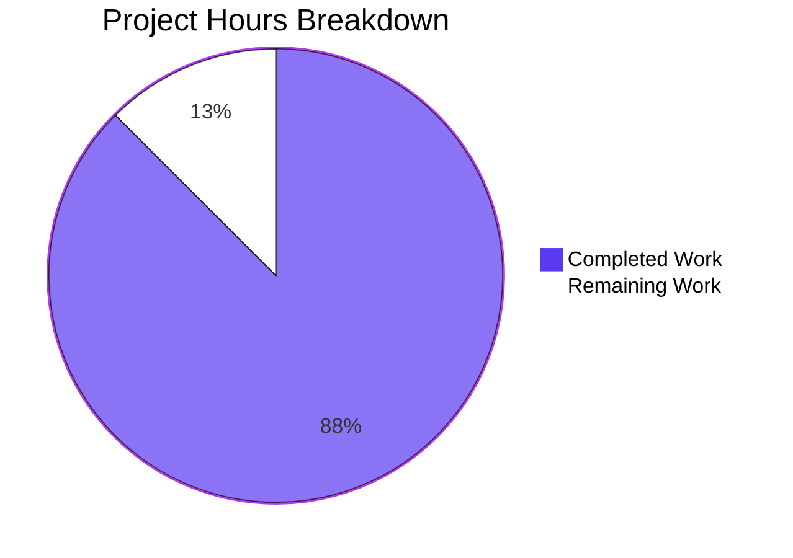
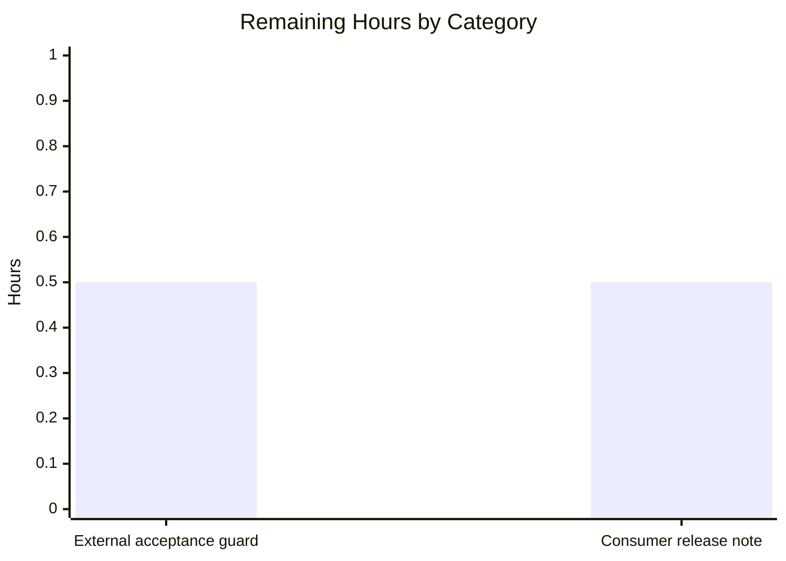

# 1. Executive Summary

## 1.1 Project Overview

Two independent artefacts sit in a repository needing only a Python 3 interpreter: `welcome.py`, a single statement that writes the bare greeting `Welcome to Blitzy` to standard output with no decoration, and `hello_world.txt`, a committed plain-text file holding that identical line exactly 99,980 times as literal content no code produces. A three-line `README.md` documents the run command, the data file's fixed count and size, and that nothing generates it. There is no server, database, dependency or build step. Its audience is anyone who runs it or needs exactly 99,980 identical lines.

## 1.2 Completion Status

The project is **88% complete**: 7.0 of the 8.0 hours in scope are delivered. (7.0 ÷ (7.0 + 1.0)) × 100 = 87.5%, reported as 88%. Completed hours cover all three artefacts and their verification; the remaining hour is path-to-production work outside the repository.



| Metric | Hours |
|---|---|
| Total Hours | 8.0 |
| Completed Hours (AI + Manual) | 7.0 |
| Remaining Hours | 1.0 |

## 1.3 Key Accomplishments

- ✅ `welcome.py` — one statement, 27 bytes, printing the greeting with no formatting, verified byte-for-byte.
- ✅ Output, exit status and empty stderr invariant under arguments, a scrubbed environment, foreign and read-only directories, pipes and concurrent runs.
- ✅ `hello_world.txt` — 99,980 identical LF-terminated lines, 1,799,640 bytes, at a digest every read reproduces.
- ✅ Every line is the same 17-character ASCII line: no padding, blank line, header, byte-order mark or CR byte.
- ✅ No generator: the data file is committed literal content and no tracked path can write it.
- ✅ Every documented acceptance command reproduces its stated output exactly, read-only.

## 1.4 Critical Unresolved Issues

**3 of 14** — the request set fourteen requirements and directives, all delivered and verified, so no open item below is undelivered. Each is an edge-case behaviour or a structural property the one-line, generator-free design accepts.

| Issue | Impact | Owner | ETA |
|---|---|---|---|
| The programme exits non-zero with the interpreter's own message when stdout cannot accept its bytes (`/dev/full`, or a consumer that closes the pipe without reading) | Low — consumers that read the output are unaffected | Repository owner | No change planned |
| The delivered stdout bytes are re-encoded when the calling environment overrides the output encoding (`PYTHONIOENCODING`) | Low — the 18-byte guarantee holds under the default encoding | Repository owner | No change planned |
| Nothing inside the repository can detect an edit or tooling normalisation that breaks the counted file's byte identity | Medium — a silent break is noticed only when the acceptance commands are re-run | Repository owner | Next change to either artefact |

## 1.5 Access Issues

No access issues identified. Nothing needs a credential, service or third-party API: the programme reads no input and opens no file, the data file is inert committed bytes, and no delivered file reads an environment variable. Verification needs only the interpreter and the operating system's text tools.

## 1.6 Recommended Next Steps

1. [Medium] Run the documented acceptance commands outside the repository on any change to either artefact, failing the change on any divergence.
2. [Medium] Re-run them after any merge or tooling change: the counted file's correctness rests on its bytes.
3. [Low] Record the two environment-dependent stdout behaviours in the release handover; the README cannot grow.
4. [Low] Treat both artefacts as final, and add no arguments, logging, error handling, manifest or build step.

# 2. Project Hours Breakdown

## 2.1 Completed Work Detail

| Component | Hours | Description |
|---|---|---|
| The print programme — `welcome.py` | 1.0 | One builtin statement that writes the greeting to standard output; 1 line / 27 bytes, ASCII with a single LF and no byte-order mark, digest-pinned, performing no file, argument or environment access |
| The counted data file — `hello_world.txt` | 1.5 | 1,799,640 bytes of committed literal content holding the line 99,980 times, one occurrence per LF-terminated line; materialised once outside the repository and committed as a single file, with no producer retained anywhere |
| Minimal documentation — `README.md` | 0.5 | Three LF-terminated lines: the run command; the data file's count, byte size and encoding; and the statement that no script, test or build step generates it |
| Acceptance verification of both artefacts | 3.0 | The nine documented acceptance commands and every named alternate, together with the byte-arithmetic, whole-file digest, line-identity, encoding, terminator and repository-listing checks, all run read-only |
| Runtime and adversarial verification | 1.0 | The programme exercised under extra and hostile arguments, a scrubbed environment, foreign and read-only working directories, pipes and concurrent runs, with before-and-after digest and timestamp comparison proving a run cannot touch the counted file |
| **Total** | **7.0** | |

Completed hours 7.0. Every component traces to a mapped deliverable of the work's scope.

## 2.2 Remaining Work Detail

| Category | Hours | Priority |
|---|---|---|
| External acceptance guard — schedule the documented command set to run outside the repository on any change touching either artefact | 0.5 | Medium |
| Consumer release note — record the two environment-dependent stdout behaviours where consumers will read them | 0.5 | Low |
| **Total** | **1.0** | |

Remaining hours 1.0. No requirement of the request is unbuilt, so both categories are path-to-production work: neither may be placed inside the repository, because the README is fixed at three lines and any test, fixture or harness asserting on the counted data file would itself be the generator the request forbids.

# 3. Test Results

Every number below comes from the acceptance command set executed against the delivered artefacts on the checkout; the project ships no test framework, runner or coverage tool, and its scope deliberately forbids adding one.

| Area / Category | Framework | Tests | Passed | Failed | Coverage | What This Proves |
|---|---|---|---|---|---|---|
| Programme process contract | Shell acceptance gate | 20 | 20 | 0 | Not measured — no coverage tooling exists by design | `python3 welcome.py` emits exactly the 18-byte greeting, exits 0 and leaves stderr empty, and does so unchanged under extra and hostile arguments, a scrubbed environment, foreign and read-only working directories, a pipe, closed and empty stdin, and 20 concurrent runs |
| Source minimality and encoding hygiene | Shell acceptance gate | 20 | 20 | 0 | Not measured — no coverage tooling exists by design | `welcome.py` is one line and 27 bytes at a fixed digest, syntactically valid, with no shebang, import, comment, docstring, main guard, argument handling or error path, and its bytes are ASCII with a single LF |
| Counted data file content contract | Shell acceptance gate | 27 | 27 | 0 | Not measured — no coverage tooling exists by design | All 99,980 lines are the identical 17-character line, LF-terminated including the last, ASCII with no byte-order mark, at exactly 1,799,640 bytes and a fixed whole-file digest |
| Documentation contract | Shell acceptance gate | 14 | 14 | 0 | Not measured — no coverage tooling exists by design | `README.md` carries exactly its three lines, and the run command it documents executes to the required output while every value it states equals the measured fact |
| Repository shape and the no-generator property | Shell acceptance gate | 13 | 13 | 0 | Not measured — no coverage tooling exists by design | Exactly three tracked files exist, no generator, writer, test or fixture does, and a programme run leaves the counted file's digest and timestamp unchanged |
| **Total** | | **94** | **94** | **0** | | |

### Not Covered

- **Interpreter versions below the floor actually exercised.** Only CPython 3.13.18 was available. The portability floor — any Python 3.0 or later, with no pin anywhere in the tree — is satisfied by the statement's form, not by execution on an older interpreter. Test on the oldest interpreter your environment must support before relying on it.
- **Kernel-level tracing of a run.** No syscall tracer is present on this host, so the proof that a run opens nothing rests on digest, size, timestamp and tree-listing stability rather than on a syscall log. Re-run the acceptance digest checks after any change instead.
- **Any runtime surface that does not exist.** There is no HTTP endpoint or route, no listening port, no database, queue, broker, cache or container, no configuration or environment read, no outbound call, no authentication surface and no deployment — so none was exercised. Confirming their absence is the correct result, not a gap.
- **Any browser-rendered surface.** The project has no HTML, CSS or JavaScript, no screen, no layout and no design system, so no page, DOM snapshot, screenshot or performance trace was produced. Any future UI would need its own validation.
- **The two edge-case behaviours as asserted contract.** A non-zero exit when stdout cannot accept bytes, and re-encoded bytes when the calling environment overrides the output encoding, were reproduced and accepted with a caveat rather than asserted as contract. Exercise them deliberately if your consumer depends on them.
- **An in-repository regression guard.** None can exist: a test or fixture that asserted on the counted data file by writing it would recreate the generator the request forbids. The documented command set is the standing regression test instead.

# 4. Runtime Validation &amp; UI Verification

The project has no server, route, screen or endpoint, so runtime validation consists of driving the programme itself and reading the counted data file back. Each line below was reproduced against the checked-out artefacts.

- ✅ **Programme execution from the repository root** — `python3 welcome.py` exits 0, writes exactly 18 bytes to stdout (the 17 characters plus one newline) and 0 bytes to stderr.
- ✅ **Output integrity** — stdout is byte-identical to `printf 'Welcome to Blitzy\n'`, one line, with no escape, quote, control or padding byte.
- ✅ **Invocation invariance** — identical output under extra and hostile arguments, under a scrubbed environment with no `PATH`, from a foreign and from a read-only working directory, through a pipe, and under six interpreter flag sets.
- ✅ **Concurrency and repeatability** — 20 concurrent runs and repeated sequential runs produce one distinct output digest, with empty stderr throughout.
- ✅ **Counted data file read integrity** — 99,980 lines, 1,799,640 bytes, the fixed whole-file digest, one distinct line, no line of any other length, LF terminators only, no byte-order mark.
- ✅ **Documented run command** — the command on the first line of `README.md` executed verbatim from the repository root produces the required 18 bytes with exit 0 and empty stderr.
- ✅ **Cross-artefact non-interference** — the counted file's digest, size and timestamp are unchanged after every programme run, and no untracked path appears.
- ✅ **Whole-tree gate** — all nine documented acceptance commands and every named alternate reproduce their stated output exactly, read-only, and leave the working tree clean.
- ⚠ **Partial — stdout that cannot accept bytes** — redirecting the greeting to a full device exits 120 with the interpreter's own `OSError: [Errno 28] No space left on device` on stderr; a consumer that closes the pipe without reading gives writer exit 120 and `BrokenPipeError`. Accepted: every settlement would add lines the one-statement contract forbids.
- ⚠ **Partial — output encoding overridden by the caller** — with `PYTHONIOENCODING=utf-16` the captured stdout is 36 bytes rather than 18; under the default and under latin-1 it is the required 18. Accepted: byte-level control would require imports the one-line contract forbids.

Never exercised at runtime, because no such surface exists: HTTP endpoints and routes, listening ports, databases, schemas, caches, queues, brokers and containers; outbound network calls and third-party integrations; authentication, sessions, tokens and credentials; configuration and environment-variable handling; background processes, schedulers and deployment; and every browser-rendered surface, for which no page, screenshot, recording or performance trace was produced. Also never exercised: any interpreter older than the one present, and any kernel-level syscall trace of a run.

# 5. Compliance &amp; Quality Review

## 5.1 Compliance Matrix

| # | Deliverable / Requirement | Status | Verified By | Notes |
|---|---|---|---|---|
| 1 | The programme prints the greeting with no formatting | ✅ Pass | `welcome.py:1`; stdout capture compared byte-for-byte with a reference | 18 bytes, one line, exit 0, empty stderr |
| 2 | The programme is as few lines as possible | ✅ Pass | `wc -l -c welcome.py`; `sha256sum welcome.py` | 1 line / 27 bytes; digest pinned; no shebang, import, comment, docstring or guard |
| 3 | The data file holds the line exactly 99,980 times | ✅ Pass | `wc -l`; `grep -c -x -F`; `sort -u`; per-line length scan | 99,980 matching, 0 differing, one distinct line |
| 4 | Exact byte size and whole-file digest | ✅ Pass | `wc -c`; `sha256sum`; byte arithmetic | 1,799,640 bytes = 99,980 × 18; digest reproduced on every read and from the committed blob |
| 5 | Exact filename and location | ✅ Pass | `git ls-files`; root listing | `hello_world.txt` at the repository root, no prefix, no variant spelling |
| 6 | Minimal documentation of the run command and the fixed facts | ✅ Pass | `README.md:1–3`; documented command executed; every documented value re-measured | Three LF-terminated lines; run command exits 0 with 18 bytes; count, size and encoding all match |
| 7 | No script generates the lines | ✅ Pass | Tree-wide sweep; digest and timestamp stability across runs | No generator, fixture, test, build or CI step; no tracked path can write the file |
| 8 | Committed content is final and immutable | ✅ Pass | Worktree digest against the committed blob digest | Identical; no writer exists anywhere in the tree or the history |
| 9 | Byte-level conventions | ✅ Pass | `od`; `tr`; `file` | ASCII, LF terminators, no byte-order mark, no CR, no non-printable byte |
| 10 | Read-only verifiability | ✅ Pass | Full gate re-run with digest, size and timestamp comparison before and after | Every data-file check is read-only; the tree is clean afterwards |
| 11 | Portability with no third-party runtime | ✅ Pass | Interpreter version and floor check; run under a scrubbed environment | One builtin call, no import, no manifest; floor of any Python 3, no pin |
| 12 | Scope discipline | ✅ Pass | Tracked inventory and absence sweep | Exactly three files; no manifest, CI, container, script, test, fixture, licence or extra documentation |

## 5.2 AAP &amp; Rule Divergences and Gaps

No divergence from any user-specified rule exists: no rules were provided for this project, so there is no rule text the delivered code could depart from. The five divergences below are departures between the work's plan and what was delivered or observed. Every one of them is recorded for the reader's awareness; none leaves a requirement unmet.

| # | What the AAP/Rule Required | What Was Delivered Instead | Why It Diverged | Impact | Remediation |
|---|---|---|---|---|---|
| 1 | §0.8.2 row 3, §0.10.1 row 3 and §0.9.2 state the repository is empty, all three files are new, and no existing file is modified | `README.md` was delivered as a whole-file replacement of a pre-existing 2-line, 48-byte scaffold committed at the initial commit | The path already existed on disk, and an existing path cannot be declared created; the required three-line content at that path could only be delivered by replacing it | None on the delivered content — the three required lines are present and no scaffold text survives — but the plan's record of that path's operation is wrong | None in code. If the plan is reused, record that path as an update rather than a creation |
| 2 | §0.13.1 states that error handling is deliberately absent and that the programme cannot fail | With stdout directed at a device that cannot accept bytes the run exits 120 with the interpreter's own `OSError: [Errno 28]` on stderr | The plan forbids the only possible settlement: catching the write error and forcing exit 0 would add lines that the one-line, fewest-tokens requirement forbids | Low — consumers that read the output are unaffected; only an unwritable destination sees it | Document and expect the behaviour; no permitted code change exists |
| 3 | §0.7.1 defines the process contract as `print` writing the fixed 18 bytes to standard output | The bytes are re-encoded when the calling environment overrides the output encoding: `PYTHONIOENCODING=utf-16` yields 36 bytes where the default and latin-1 yield 18 | The contract is defined for the interpreter's default text encoding; byte-level control would need imports and lines the minimum-lines instruction forbids | Low — the 18-byte guarantee holds under the default encoding, and only a caller that overrides it sees other bytes | Leave the output encoding at its default; note the behaviour for consumers |
| 4 | §0.2.1 and §0.3.1 record the execution environment's interpreter as CPython 3.12.3 | The project was delivered and verified on CPython 3.13.18 | The plan's environment note is out of date; the binding requirement pins no version and no delivered file references one, so nothing depended on the figure | None | Unnecessary — the portability floor is any Python 3 and is met |
| 5 | §0.6.3 lists a conditional fallback of listing the checkout root for the three names when the files are not yet tracked | The fallback yields four entries, because an empty platform directory sits beside the three delivered files | That directory is platform scratch: it holds no file, cannot be tracked by version control, and the scope forbids touching or adding any path beyond the three mapped deliverables | None on the inventory — the governing listing of tracked files reports exactly the three names | Assert on the tracked-file listing, which yields exactly the three mapped paths |

**1. README operation classification.** The initial commit already tracked `README.md`, holding a two-line, 48-byte platform scaffold (`# ep_check_estimates-cbd566c7` and `Created by Blitzy`) — visible with `git show a0a7d24:README.md` and `git ls-tree -r a0a7d24`. The delivered file replaces it whole at `808c800`, leaving no scaffold line in the tree, and `grep -c -iE 'ep_check_estimates|Created by Blitzy' README.md` returns 0. Because an existing path cannot be recorded as newly created, the plan's classification of that path — and its accompanying statement that no existing file was modified — does not hold for it, even though the content requirement does. The reader needs to decide nothing here; the remedy is a record-keeping correction if the plan is reused, not a code change.

**2. The programme's behaviour when stdout cannot accept its bytes.** The plan records error handling as deliberately absent and states the programme cannot fail. That reading holds for every input the programme has, but not for the output device: `python3 welcome.py > /dev/full` exits 120 with `Exception ignored on flushing sys.stdout: OSError: [Errno 28] No space left on device` on stderr, and a consumer that closes the pipe without reading (`python3 welcome.py | head -c 0`) gives writer exit 120 with `BrokenPipeError`. The failure is the interpreter's own flush, not a programme path, and the only settlement — catching it and forcing exit 0 — would add the very lines the one-line requirement forbids. Impact is confined to a consumer that cannot accept the bytes; decide whether your consumer needs a defined exit contract, and if so accept that the one-line contract must be relaxed to provide it.

**3. The stdout byte contract under an overridden encoding.** The plan defines the process contract as the fixed 18 bytes on standard output. Under the interpreter's default encoding, and under `latin-1` or `ascii`, that is exactly what a caller receives. Set `PYTHONIOENCODING=utf-16` in the calling environment and the same programme yields 36 bytes (`57 00 65 00 … 0a 00`), because the interpreter encodes the text under the encoding the environment selected. The programme cannot prevent this without byte-level output control, which needs imports and lines the minimum-lines instruction forbids. Decide whether any caller of yours sets an output encoding; if one does, that caller will not see the documented bytes.

**4. The plan's interpreter note.** The plan records the execution environment's interpreter as CPython 3.12.3; delivery and verification ran on CPython 3.13.18. Nothing was built on the figure: the portability requirement's floor is any Python 3.0 or later with no upper bound and no pin, no delivered file reads or reports an interpreter version, and every acceptance command produces identical output under the interpreter present. The note is simply stale. No action is needed beyond not treating it as a pinned version when reading the plan.

**5. The conditional root-listing fallback.** The acceptance set names a fallback that lists the checkout root when the files are not yet tracked; its precondition does not hold here, because all three files are tracked, and its result would be four entries rather than three: beside `README.md`, `hello_world.txt` and `welcome.py` sits an empty platform directory holding no file, which version control cannot track and which the scope forbids touching or adding to. The governing check — listing tracked files — reports exactly the three mapped paths. Assert on that listing rather than on a bare directory count, and the check reads as documented.

# 6. Risk Assessment

| Risk | Category | Severity | Probability | Mitigation | Status |
|---|---|---|---|---|---|
| An edit, merge tool or checkout conversion changes the counted file's bytes — line endings, a byte-order mark, or a trimmed final newline — with nothing in the tree to catch it | Technical | Medium | Unlikely | The documented acceptance commands catch it: the whole-file digest subsumes every byte, and the file is committed literal content no code path can write | Open |
| No automated guard exists inside the repository, because a test or fixture asserting on the counted file would itself be the forbidden generator | Operational | Medium | Certain as a structural fact | Run the documented command set after any change touching either artefact; the remaining work schedules exactly that, outside the repository | Open — accepted by design |
| Any later addition to the programme breaks the one-line, 27-byte contract and the pinned digest | Technical | Low | Low | The line, byte and digest checks are the gate; the file is final as written and every addition is a defect against its scope | Open |
| A consumer that redirects the greeting to a device that cannot accept bytes meets an interpreter error and a non-zero exit rather than a defined exit contract | Operational | Low | Unlikely | Read the output normally, or redirect to a file or a reading consumer; the behaviour is recorded for consumers in the remaining work | Open — accepted by design |
| A caller that overrides the output encoding receives re-encoded bytes rather than the documented 18 | Integration | Low | Unlikely | Leave the output encoding at its default; note the behaviour wherever the consuming system is configured | Open — accepted by design |
| The documented count and byte size are prose bound to nothing, so a change to the data file would leave them stale | Operational | Low | Possible | Re-measure both values and update the README in the same change; the digest check is the trigger to remember | Open |
| A consumer that asserts the checkout root holds exactly three entries sees four, because of an empty platform directory that holds no file and cannot be tracked | Integration | Low | Unlikely | Assert on the tracked-file listing, which reports exactly the three mapped paths | Open |
| The project has no attacker-reachable surface — no input, no file access, no process spawn, no network call, no credential — but the property that must keep holding is that no run can alter the counted file | Security | Low | Unlikely | No file-write path exists in the tree or in the commit history; the acceptance digest check re-confirms it after any change | Closed by design, re-checked by the gate |

No unresolved compilation error, failing test or missing core behaviour contributes to this table: the programme executes, the data file is byte-exact, and every documented acceptance command reproduces its stated output.

# 7. Visual Project Status


**Completion: 88%** — 7.0 of 8.0 hours delivered, with 1.0 hour of path-to-production work remaining.



| Status | Hours | Share |
|---|---|---|
| Completed Work | 7.0 | 88% |
| Remaining Work | 1.0 | 12% |
| **Total** | **8.0** | **100%** |

| Remaining Category | Hours | Priority |
|---|---|---|
| External acceptance guard | 0.5 | Medium |
| Consumer release note | 0.5 | Low |

# 8. Summary &amp; Recommendations

**What was delivered.** The repository now holds exactly three files. `welcome.py` is a single statement, 27 bytes, that writes the bare greeting `Welcome to Blitzy` to standard output — 18 bytes, exit 0, empty stderr, with no formatting of any kind. `hello_world.txt` is 1,799,640 bytes of committed literal content holding that identical line 99,980 times, one occurrence per LF-terminated line, at a whole-file digest every read reproduces. `README.md` is three lines stating the run command, the data file's count, byte size and encoding, and that no script, test or build step generates it. No generator, manifest, dependency, build step, test framework, container or configuration exists anywhere in the tree or in its history.

**What was verified.** Both artefacts were exercised against every documented acceptance command and every named alternate, and the results matched their stated outputs exactly: 94 checks executed, 94 passed, 0 failed, across the programme's process contract, the source's minimality and encoding hygiene, the counted file's content contract, the documentation contract, and the repository's shape and no-generator property. The programme's output proved invariant under extra and hostile arguments, a scrubbed environment, foreign and read-only working directories, pipes and 20 concurrent runs, and a run leaves the counted file's digest and timestamp untouched. Read-only verifiability was confirmed by re-checking every digest, size and timestamp after the whole gate ran.

**The gaps that remain, and the critical path.** The project is 88% complete: 7.0 of 8.0 hours delivered, with one hour of path-to-production work. Both remaining items are outside the repository by necessity — the README is fixed at three lines, and a test or fixture asserting on the counted data file would itself be the generator the request forbids. The first is an external guard that re-runs the documented command set on any change touching either artefact and fails the change on any divergence; the second is a note for consumers recording that the programme exits non-zero with the interpreter's own message when stdout cannot accept bytes, and that its bytes are re-encoded if the calling environment overrides the output encoding. Nothing on the critical path requires new code.

**Success metrics.** Four figures fix the delivery, and all of them hold and are reproducible from the documented commands in under a second: the programme is 1 line and 27 bytes with digest `79ad31b9300525e855715722c82219fde4642214f5501577534dc40b569b6360`, and the counted file holds 99,980 lines and 1,799,640 bytes with digest `101e8751950d70764669addaa5000df3a05d1bfab4c33139e691b9525f4a6ed6`. A fifth metric is the acceptance gate itself: every row matching its stated output means no regression has been introduced.

**Production readiness.** The two artefacts are complete, correct and final against every requirement that governs them, and are ready for their stated purpose: an evaluator runs `python3 welcome.py` and sees exactly the greeting, and any consumer reads a plain-text file of exactly 99,980 identical lines. This readiness should be read in the project's own terms — it is a deliberately minimal deliverable with no operational surface, no error handling by design, no monitoring and no automated regression guard — so "ready" means ready as the two artefacts the request specifies, not hardened production software. The recommendation is to adopt them as final, run the documented gate wherever they are consumed, and treat any future change to the line count as a re-materialisation of the file's bytes outside the repository rather than an invitation to introduce a producer.

# 9. Development Guide

### System Prerequisites

- **Any Python 3 interpreter**, version 3.0 or later, with no upper bound and no pin: the programme is one builtin call, valid from the release at which `print` became a function with a default terminator. The environment this was verified on provides CPython 3.13.18.
- **A POSIX shell and the operating system's own text tools** — `wc`, `grep`, `sort`, `uniq`, `awk`, `od`, `tr`, `head`, `tail`, `file`, `stat`, `sha256sum` and `git` — for the verification commands below.
- **Nothing else.** No package manager, virtual environment, compiler, container runtime, database, broker or service is involved, and no operating-system package needs installing.

### Environment Setup

There is no environment to set up. The project declares no package, so there is no dependency to install and no virtual environment to create — do not add one, because the repository's scope holds exactly three files. It reads no environment variable and requires no secret, no configuration file and no path configuration.

```bash
# Confirm the interpreter is available; no installation step exists.
python3 --version
# Python 3.13.18
```

### Dependency Installation

None. The project's only runtime requirement is a Python 3 interpreter, present already. There is no manifest, lockfile or package index to resolve, and no file should be added to create one.

### Application Startup

There is no server, port, service, database or container to start, and therefore no startup sequence, no background process and no port to free. The programme is invoked directly, and the working directory is the repository root:

```bash
python3 welcome.py
# Welcome to Blitzy
```

The programme writes the 17 characters plus one newline — 18 bytes — to standard output, writes nothing to standard error, and exits 0.

```bash
python3 welcome.py > out.txt 2> err.txt; echo "exit=$?"
wc -c out.txt err.txt
# exit=0
# 18 out.txt
#  0 err.txt
```

There is no build step. To syntax-check the source without producing bytecode in the tree:

```bash
python3 -c 'compile(open("welcome.py").read(), "welcome.py", "exec")'
# (no output — the source compiles)
```

### Verification Steps

Each command below is read-only against the artefacts and prints the stated output. Run them from the repository root, in any order.

```bash
# The programme's own contract: one line, 27 bytes, at a fixed digest.
wc -l -c welcome.py
sha256sum welcome.py
# " 1 27 welcome.py"
# 79ad31b9300525e855715722c82219fde4642214f5501577534dc40b569b6360  welcome.py
```

```bash
# The counted file's count, size and whole-file digest.
wc -l hello_world.txt
wc -c hello_world.txt
sha256sum hello_world.txt
# 99980 hello_world.txt
# 1799640 hello_world.txt
# 101e8751950d70764669addaa5000df3a05d1bfab4c33139e691b9525f4a6ed6  hello_world.txt
```

```bash
# Every line is the identical 17-character line, LF-terminated, with no byte-order mark.
grep -c -x -F 'Welcome to Blitzy' hello_world.txt   # 99980
grep -c -v -x -F 'Welcome to Blitzy' hello_world.txt  # 0  (exits 1 — the printed count is the evidence)
sort -u hello_world.txt | wc -l                      # 1
od -An -tx1 -N 3 hello_world.txt                     # " 57 65 6c"  (Wel — no byte-order mark)
tail -c 1 hello_world.txt | od -An -tx1              # " 0a"        (the last line is terminated too)
tr -cd '\r' < hello_world.txt | wc -c                # 0           (LF terminators, never CRLF)
```

```bash
# The repository holds exactly the three mapped files and nothing else tracked.
git ls-files
# README.md
# hello_world.txt
# welcome.py
```

The same gate, run as one block, reproduces every value above in under a second. It reads the artefacts only; the working tree is unchanged afterwards.

### Example Usage

Run the programme and read the data file:

```bash
python3 welcome.py
# Welcome to Blitzy

# The file's own consumer view: 99,980 identical lines, 18 bytes each.
head -n 1 hello_world.txt | od -An -c
#    W   e   l   c   o   m   e       t   o       B   l   i   t   z   y  \n
head -n 3 hello_world.txt
# Welcome to Blitzy
# Welcome to Blitzy
# Welcome to Blitzy
```

Extract the greeting's fields or count with tools independent of the programme:

```bash
head -n 1 hello_world.txt | awk '{print NF, $1, $3}'
# 3 Welcome Blitzy
grep -c 'Blitzy' hello_world.txt
# 99980
```

### Troubleshooting

**Common Issues and Resolutions**

| Symptom | Cause | Resolution |
|---|---|---|
| `Permission denied` when running `./welcome.py` | The file is not directly executable: it has no shebang by design, and the documented invocation is through the interpreter | Invoke `python3 welcome.py` from the repository root |
| `python3: command not found` | No Python 3 interpreter on the path | Install any Python 3 from your platform's package manager, or call the interpreter by its absolute path; the project pins no version |
| The programme exits 120 with `OSError: [Errno 28] No space left on device` on stderr | Standard output cannot accept the bytes — for example a redirect to a full device | Expected and accepted: the interpreter reports its own write failure and the one-statement programme has no error path. Redirect to a file that can accept the bytes, or read the output normally |
| Writer exit 120 with `BrokenPipeError: [Errno 32] Broken pipe` on stderr | A consumer closed the pipe without reading, such as `python3 welcome.py | head -c 0` | Expected and accepted. Use a consumer that reads the output, such as `cat`, `wc`, `od` or a file redirect |
| `python3 welcome.py | wc -c` prints 36 instead of 18 | The calling environment overrides the output encoding, for example `PYTHONIOENCODING=utf-16` | Unset `PYTHONIOENCODING` or leave the output encoding at its default; the 18-byte contract holds under the default, `latin-1` and `ascii` |
| `wc -l hello_world.txt` reports a count other than 99980, or the digest differs | A tool has normalised the file's bytes — a converted line ending, an inserted byte-order mark, or a trimmed final newline | Restore the file's bytes from the commit (`git checkout -- hello_world.txt`) and re-run the verification steps. Never repair it with a script: the file is literal content and no producer may exist |
| `git ls-files` and a directory listing disagree on the file count | An empty platform directory sits beside the three delivered files; version control cannot track an empty directory | Trust `git ls-files`, which reports exactly the three mapped paths |

**Do not** add a manifest, a test, a fixture, a build step, a `Makefile`, a CI workflow, a container file, an argument parser, logging or error handling. Each was deliberately excluded, and each either adds a line the programme's contract forbids or introduces the very generator the counted file's requirement prevents.

# 10. Appendices

### A. Command Reference

All commands run from the repository root.

| Command | Purpose | Expected output |
|---|---|---|
| `python3 welcome.py` | Run the programme | `Welcome to Blitzy` |
| `python3 welcome.py > out 2> err; echo $?` | Capture the streams and the exit status | `0`; `out` 18 bytes, `err` 0 bytes |
| `python3 welcome.py | wc -c` | Byte count of standard output | `18` |
| `python3 welcome.py | wc -l` | Line count of standard output | `1` |
| `python3 -c 'compile(open("welcome.py").read(), "welcome.py", "exec")'` | Syntax-check the source without writing bytecode | no output |
| `wc -l -c welcome.py` | The programme's minimality | ` 1 27 welcome.py` |
| `sha256sum welcome.py` | The programme's whole-file digest | `79ad31b9300525e855715722c82219fde4642214f5501577534dc40b569b6360  welcome.py` |
| `printf 'print("Welcome to Blitzy")\n' \| sha256sum` | Independently reproduce the programme's digest | the same digest as above |
| `wc -l hello_world.txt` | The counted file's line count | `99980 hello_world.txt` |
| `wc -c hello_world.txt` | The counted file's byte size | `1799640 hello_world.txt` |
| `sha256sum hello_world.txt` | The counted file's whole-file digest | `101e8751950d70764669addaa5000df3a05d1bfab4c33139e691b9525f4a6ed6  hello_world.txt` |
| `grep -c -x -F 'Welcome to Blitzy' hello_world.txt` | Lines exactly equal to the greeting | `99980` |
| `grep -c -v -x -F 'Welcome to Blitzy' hello_world.txt` | Lines that differ | `0` — exits 1 by design; the printed count is the evidence |
| `sort -u hello_world.txt \| wc -l` | Distinct lines | `1` |
| `sort hello_world.txt \| uniq -c` | Occurrences of the single line | `  99980 Welcome to Blitzy` |
| `awk 'length($0) != 17 { n++ } END { print n+0 }' hello_world.txt` | Lines that are not 17 characters | `0` |
| `od -An -tx1 -N 3 hello_world.txt` | First three bytes — no byte-order mark | ` 57 65 6c` |
| `head -c 18 hello_world.txt \| od -An -tx1` | The first full record in hex | `57 65 6c 63 6f 6d 65 20 74 6f 20 42 6c 69 74 7a 79 0a` |
| `tail -c 1 hello_world.txt \| od -An -tx1` | Final terminator | ` 0a` |
| `tr -cd '\r' < hello_world.txt \| wc -c` | Carriage-return bytes | `0` |
| `git ls-files` | The tracked inventory | `README.md`, `hello_world.txt`, `welcome.py` |

### C. Key File Locations

| Path | Role |
|---|---|
| `welcome.py` | The whole programme: one line, 27 bytes, printing the greeting to standard output |
| `hello_world.txt` | The counted data file: 99,980 identical LF-terminated lines, 1,799,640 bytes |
| `README.md` | Three lines: the run command, the data file's count/size/encoding, and the no-generator statement |

There are no other directories, packages, configuration files, test files or build inputs in the repository.

### D. Technology Versions

| Component | Version | Note |
|---|---|---|
| Python (CPython) | 3.13.18 | The version verified here. The project's floor is any Python 3.0 or later, with no upper bound and no pin |
| Git | 2.56.0 | Used only to list the tracked inventory and to read the committed blobs |
| Third-party packages | none | The programme uses one Python builtin; no manifest is declared and none may be added |

### E. Environment Variable Reference

None. No delivered file reads an environment variable, and no variable or secret is required to run, verify or consume the project. The programme's output is not affected by the environment except for one interpreter-level behaviour, recorded under *Troubleshooting*: setting `PYTHONIOENCODING` to a non-ASCII-compatible encoding changes the bytes the interpreter writes.

### F. Developer Tools Guide

| Tool | Use here |
|---|---|
| `wc` | Line and byte counts for both artefacts |
| `sha256sum` | The whole-file digests that fix both artefacts |
| `grep` | Line-identity and byte-class checks |
| `sort`, `uniq`, `awk` | Distinct-line, occurrence and field-width checks |
| `od`, `tr`, `head`, `tail` | Byte-level inspection: terminator, encoding, absence of a byte-order mark |
| `file` | Confirms the data file is plain ASCII text |
| `git` | The tracked inventory and the committed blob digests |
| `python3 -c 'compile(...)'` | Syntax check that writes no bytecode into the tree |

No linter, formatter, type checker, test runner or coverage tool is installed, and none may be added: the project's scope excludes them, and a file-based test asserting on the counted data file would itself become the generator that requirement forbids. The command set in Appendix A is the verification surface.

### G. Glossary

| Term | Meaning |
|---|---|
| AAP (Agent Action Plan) | The technical specification for this work: its deliverables, requirements, directives and acceptance set |
| Acceptance gate | The set of read-only commands and programme runs whose stated outputs together prove the artefacts are correct |
| Byte-order mark (BOM) | A signature at the start of a text file; deliberately absent here, and its presence would break both the byte count and the digest |
| Counted data file | `hello_world.txt` — committed literal content holding the greeting exactly 99,980 times, produced by no code in the repository |
| Digest (SHA-256) | The whole-file hash that fixes an artefact's every byte; any change to any byte changes it |
| LF | Line feed (`0x0a`), the terminator after every line including the last; never CR (`0x0d`) and never CRLF |
| No-generator property | No code path in the repository creates, appends to, rewrites or regenerates the counted data file |
| Path-to-production | Work needed to put the delivered artefacts into service: here an external acceptance guard and a consumer note, both outside the repository |
| Sanctioned absence | Something deliberately left out of the project's scope — a test suite, CI, manifest, container, configuration or extra documentation — and not outstanding work |
